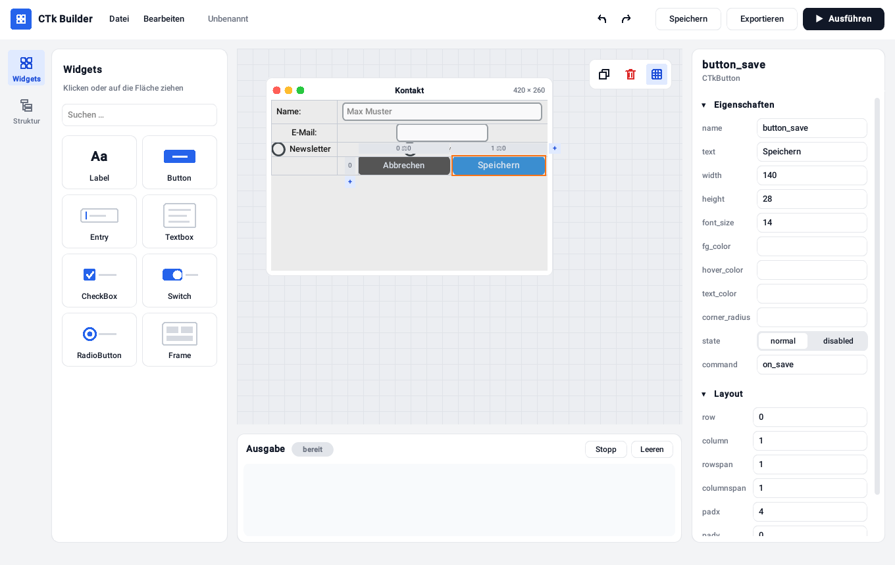
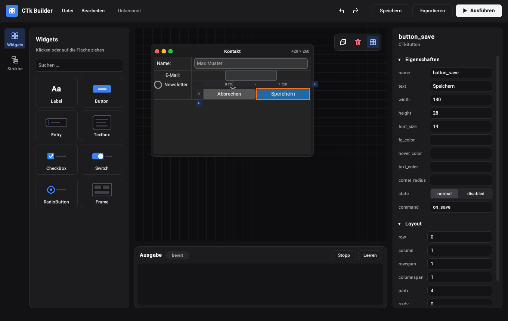

# CTk Builder

[](https://github.com/SkyxDev0/tkinter-gui-builder/actions/workflows/build.yml)
[](LICENSE)

Drag & Drop GUI-Builder für [CustomTkinter](https://github.com/TomSchimansky/CustomTkinter):
Oberflächen im `grid()`-Layout zusammenklicken und sauberen, lesbaren Python-Code exportieren.



## Funktionen

- **Widgets:** Label, Button, Entry, Textbox, CheckBox, Switch, RadioButton und Frame – Frames lassen sich beliebig verschachteln
- **Drag & Drop:** aus der Palette auf eine Zelle ziehen, Widgets verschieben oder tauschen; ein Drop neben das Raster legt automatisch eine neue Zeile oder Spalte an
- **Echte Vorschau:** Die Arbeitsfläche zeigt echte CustomTkinter-Widgets im echten `grid()`
- **Raster im Griff:** Zeilen-/Spaltenköpfe mit `weight`, `minsize` und `uniform`, Kontextmenü zum Einfügen und Löschen
- **Eigenschaften-Panel** mit Prüfung jeder Eingabe; jede Änderung lässt sich rückgängig machen
- **Sauberer Export** in zwei Dateien – generierter Layout-Code und deine eigene Logik bleiben getrennt
- **▶ Ausführen** startet das Programm direkt aus dem Builder, Ausgaben erscheinen im Ausgabe-Panel
- **Moderne Oberfläche** im hellen und dunklen Modus

## Herunterladen

### Fertige App (empfohlen)

Unter **[Releases](https://github.com/SkyxDev0/tkinter-gui-builder/releases/latest)** die Datei für dein System herunterladen. Die Apps bringen Python und CustomTkinter mit – es muss nichts installiert werden.

| System | Datei | Starten |
|---|---|---|
| macOS (Apple Silicon) | `CTk-Builder-<version>-macOS-AppleSilicon.zip` | entpacken, `CTk Builder.app` in „Programme“ ziehen und öffnen |
| Windows | `CTk-Builder-<version>-Windows.exe` | doppelklicken |
| Linux | `CTk-Builder-<version>-Linux.tar.gz` | entpacken, `./ctk-builder` starten |

**Erster Start:** Die Apps sind nicht signiert, daher warnt das Betriebssystem einmalig.

- **macOS:** Beim ersten Öffnen erscheint eine Warnung. Unter *Systemeinstellungen → Datenschutz & Sicherheit* auf **„Trotzdem öffnen“** klicken – oder im Terminal:
  ```bash
  xattr -dr com.apple.quarantine "/Applications/CTk Builder.app"
  ```
- **Windows:** Bei „Der Computer wurde durch Windows geschützt“ auf **„Weitere Informationen“ → „Trotzdem ausführen“** klicken.

Auf Macs mit Intel-Prozessor die Installation mit Python (unten) verwenden.

### Mit Python (alle Systeme)

Voraussetzung ist Python 3.10 oder neuer mit Tk 8.6 (unter macOS Python von [python.org](https://www.python.org/downloads/) oder Homebrew mit `python-tk` – das vorinstallierte System-Python reicht nicht).

```bash
pip install "git+https://github.com/SkyxDev0/tkinter-gui-builder.git"
ctk-builder
```

Alternativ die `.whl`-Datei aus den Releases installieren: `pip install ctk_builder-<version>-py3-none-any.whl`.

## Bedienung

1. **Widgets einfügen:** Ein Widget aus der Palette auf die Arbeitsfläche ziehen. Ein einfacher Klick fügt es in die nächste freie Zelle ein.
2. **Auswählen und bearbeiten:** Ein Widget anklicken – rechts erscheinen seine Eigenschaften und sein Layout (`row`, `column`, `sticky`, Abstände …). Eingaben werden mit Enter übernommen; ungültige Werte werden rot markiert.
3. **Anordnen:** Widgets per Drag & Drop verschieben; liegt in der Zielzelle schon ein Widget, tauschen beide die Plätze. Pfeiltasten verschieben das ausgewählte Widget zellenweise.
4. **Raster einstellen:** Einen Zeilen- oder Spaltenkopf anklicken, um `weight`, `minsize` und `uniform` zu setzen. Rechtsklick fügt Zeilen/Spalten ein oder löscht leere. `+` hängt eine neue an.
5. **Fenster einstellen:** Auf eine freie Stelle neben dem Fenster klicken – dann lassen sich Titel, Größe, Klassenname, Modus (hell/dunkel) und Farbthema setzen.
6. **Speichern, Exportieren, Ausführen:** Das Projekt wird als `*.ctkb.json` gespeichert. **Exportieren** erzeugt den Python-Code daneben, **▶ Ausführen** speichert, exportiert und startet das Programm.

Die linke Leiste schaltet zwischen der Widget-Palette und dem **Strukturbaum** um – dort lässt sich jedes Widget auch dann auswählen, wenn es auf der Fläche verdeckt ist.

### Tastenkürzel

| Aktion | macOS | Windows / Linux |
|---|---|---|
| Rückgängig / Wiederholen | `Cmd+Z` / `Cmd+Shift+Z` | `Strg+Z` / `Strg+Shift+Z` |
| Duplizieren | `Cmd+D` | `Strg+D` |
| Löschen | `Entf` / `⌫` | `Entf` / `Rücktaste` |
| Verschieben | Pfeiltasten | Pfeiltasten |
| Neu / Öffnen / Speichern | `Cmd+N` / `Cmd+O` / `Cmd+S` | `Strg+N` / `Strg+O` / `Strg+S` |
| Exportieren / Ausführen | `Cmd+E` / `Cmd+R` | `Strg+E` / `Strg+R` |

## Der exportierte Code

Für ein Projekt `kontakt.ctkb.json` entstehen zwei Dateien:

- **`kontakt_ui.py`** – das Layout. Wird bei jedem Export neu geschrieben, also nicht von Hand ändern.
- **`kontakt.py`** – deine Logik. Wird nur beim ersten Export angelegt und danach **nie** überschrieben.

```python
# kontakt.py
from kontakt_ui import KontaktUI


class Kontakt(KontaktUI):
    def on_save(self):
        print("Name:", self.entry_name.get())


if __name__ == "__main__":
    app = Kontakt()
    app.mainloop()
```

Jedes Widget ist als `self.<name>` erreichbar; für jeden eingetragenen `command` gibt es eine Methode, die du in der Logik-Datei überschreibst. Das Programm braucht zum Starten nur `pip install customtkinter`.



## Entwicklung

```bash
git clone https://github.com/SkyxDev0/tkinter-gui-builder.git
cd tkinter-gui-builder
python3 -m venv .venv
.venv/bin/pip install -e ".[dev]"     # Linux zusätzlich: sudo apt-get install -y python3-tk xvfb

.venv/bin/python -m ctk_builder        # Builder starten
.venv/bin/pytest                       # Tests (macOS / Linux mit Desktop)
xvfb-run -a .venv/bin/pytest           # Tests unter Linux ohne Display
```

Ohne Display werden die Oberflächentests übersprungen; die CI lässt sie mit virtuellem Display laufen.

### App selbst bauen

```bash
.venv/bin/pip install -e ".[app]"
.venv/bin/python tools/build.py        # Ergebnis in dist/
.venv/bin/python tools/smoke_test.py   # prüft die gebaute App
.venv/bin/python tools/package.py      # Download-Datei in release/
```

### Neue Version veröffentlichen

1. Version in `ctk_builder/__init__.py` erhöhen.
2. Release-Notizen in `docs/releases/v<version>.md` schreiben.
3. Auf GitHub unter **Actions → Tests & Builds → Run workflow** den Branch `main` wählen, den Haken
   **„Release … veröffentlichen“** setzen und starten – oder einen Tag pushen:
   `git tag v<version> && git push origin v<version>`.

GitHub Actions testet, baut die Apps für macOS, Windows und Linux, prüft sie und legt das Release mit allen Downloads an.

### Projektaufbau

```
ctk_builder/
  model.py, commands.py   Projektmodell und Befehle mit Undo/Redo
  project_io.py           Projektdateien (*.ctkb.json)
  codegen.py, exporter.py Code-Generator und Export
  ui/                     Oberfläche (Palette, Arbeitsfläche, Eigenschaften …)
tools/                    App bauen, prüfen und verpacken
docs/                     Spezifikation, Implementierungspläne, Release-Notizen
```

Details zum Entwurf: [`docs/superpowers/specs/2026-10-13-ctk-gui-builder-design.md`](docs/superpowers/specs/2026-10-13-ctk-gui-builder-design.md)

## Lizenz

[MIT](LICENSE) – frei nutzbar, auch kommerziell.
